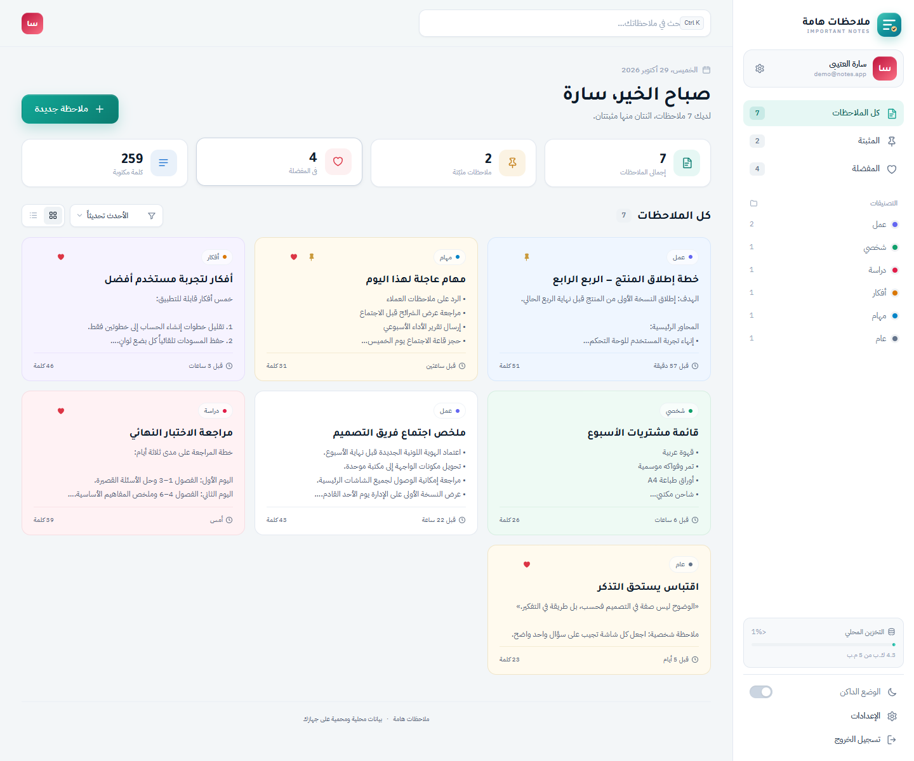
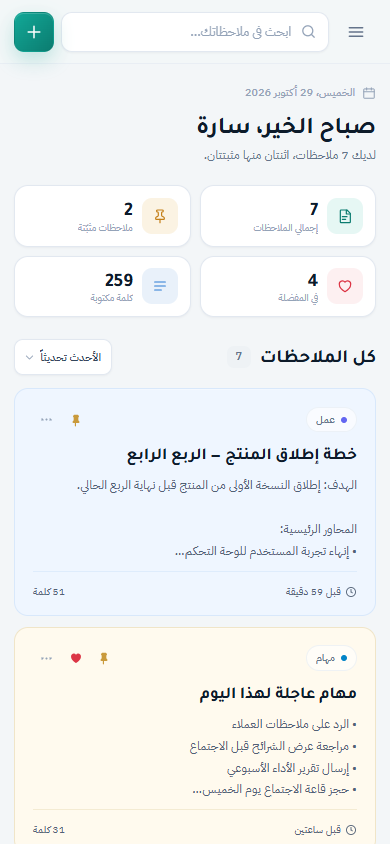

# مساحة التدوين — Writing Space

تطبيق ملاحظات عربي أنيق بواجهة RTL كاملة، مبني بـ HTML وCSS وJavaScript، ويعتمد على **Supabase** للمصادقة وقاعدة البيانات.

يتيح إنشاء حساب خاص لكل مستخدم (بريد إلكتروني + كلمة مرور)، مع عزل كامل للملاحظات بين الحسابات عبر **Row Level Security**، ومزامنة البيانات بين الأجهزة.

**النسخة المنشورة:** <https://digitalstudio2.github.io/important-notes/>



<p align="center">
  
</p>

---

## المحتويات

- [المزايا](#المزايا)
- [التقنيات](#التقنيات)
- [إعداد Supabase](#إعداد-supabase)
- [بيانات الدخول التجريبية](#بيانات-الدخول-التجريبية)
- [التشغيل محلياً](#التشغيل-محلياً)
- [طريقة الاستخدام](#طريقة-الاستخدام)
- [اختصارات لوحة المفاتيح](#اختصارات-لوحة-المفاتيح)
- [البنية والملفات](#البنية-والملفات)
- [قاعدة البيانات ونموذج البيانات](#قاعدة-البيانات-ونموذج-البيانات)
- [الأمان وحدوده](#الأمان-وحدوده)
- [النسخ الاحتياطي والاستيراد](#النسخ-الاحتياطي-والاستيراد)
- [التوافق مع المتصفحات](#التوافق-مع-المتصفحات)
- [التخصيص](#التخصيص)
- [النشر على GitHub Pages](#النشر-على-github-pages)
- [التحقق والاختبار](#التحقق-والاختبار)

---

## المزايا

### الحسابات والخصوصية
- تسجيل حساب جديد بالاسم والبريد الإلكتروني وكلمة المرور عبر **Supabase Auth**.
- تسجيل دخول آمن، وكلمات المرور تُخزَّن وتُشفَّر في Supabase ولا تمر عبر كود التطبيق.
- عزل كامل للملاحظات: سياسات RLS تمنع أي مستخدم من قراءة أو تعديل بيانات غيره.
- جلسات محفوظة مع خيار «تذكرني» (تبويب واحد أو جلسة دائمة).
- إدارة الملف الشخصي: تعديل الاسم ولون الصورة الرمزية.
- تغيير كلمة المرور مع التحقق من الكلمة الحالية.
- حذف الحساب وكل بياناته نهائياً عبر دالة آمنة في قاعدة البيانات.
- حساب تجريبي جاهز لاستكشاف التطبيق فوراً.

### الملاحظات والتنظيم
- إنشاء وتعديل وحذف الملاحظات.
- تصنيفات جاهزة: عمل، شخصي، دراسة، أفكار، مهام، عام.
- تثبيت الملاحظات المهمة في الأعلى، وإضافة أي ملاحظة إلى المفضلة.
- ستة ألوان لبطاقات الملاحظات.
- بحث فوري في العناوين والمحتوى.
- فرز حسب آخر تعديل، تاريخ الإنشاء، أو العنوان أبجدياً.
- عرض شبكي أو قائمة، مع تذكّر اختيارك.
- عدّاد كلمات لكل ملاحظة، وإحصائيات عامة.
- حالات فارغة واضحة ورسوم متحركة خفيفة تحترم إعداد تقليل الحركة.

### المظهر وتجربة الاستخدام
- تصميم مؤسسي عربي كامل RTL مبني على متغيرات CSS.
- ثلاثة أنماط: فاتح، داكن، ومتابعة نظام التشغيل.
- استجابة كاملة من الهاتف إلى الشاشات العريضة.
- نافذة محرر ملاحظات متكاملة مع اختيار التصنيف واللون.
- إشعارات Toast، ونوافذ تأكيد، ونوافذ حوارية قابلة للوصول بلوحة المفاتيح.
- دعم قارئات الشاشة وتسميات ARIA.
- رسائل خطأ عربية واضحة ومعالجة لحالات انقطاع الشبكة.

### البيانات
- تصدير كل الملاحظات إلى ملف JSON.
- استيراد ملاحظات من نسخة احتياطية مع تنظيف وتحقّق كامل.
- حذف جميع الملاحظات مع إمكانية التراجع الفوري.
- مزامنة تلقائية بين الأجهزة عند تسجيل الدخول بالحساب نفسه.

---

## التقنيات

| الطبقة | التقنية |
| --- | --- |
| الواجهة | HTML5 + CSS3 + JavaScript (Vanilla، بدون بناء) |
| المصادقة | Supabase Auth (Email + Password) |
| قاعدة البيانات | Supabase Postgres |
| الحماية | Row Level Security + سياسات لكل صف |
| استضافة الواجهة | GitHub Pages (ملفات ثابتة) |
| مكتبة العميل | `@supabase/supabase-js` عبر CDN |

لا توجد حزم npm ولا خطوة build. المشروع يعمل مباشرة من أي خادم ثابت.

---

## إعداد Supabase

### 1) إنشاء الجداول وتفعيل الحماية

افتح مشروع Supabase ثم:

**SQL Editor → New query**، والصق محتوى الملف:

```text
supabase/schema.sql
```

ثم اضغط **Run**.

هذا الملف ينشئ:

- `public.profiles` — ملف شخصي لكل مستخدم مرتبط بـ `auth.users`.
- `public.notes` — الملاحظات المرتبطة بمالكها.
- الفهارس اللازمة للسرعة.
- Trigger لتحديث `updated_at` تلقائياً.
- Trigger لإنشاء ملف شخصي تلقائياً عند تسجيل مستخدم جديد.
- تعبئة ملفات شخصية للمستخدمين الموجودين مسبقاً.
- سياسات RLS للقراءة والإضافة والتعديل والحذف.
- دالة `delete_own_account()` لحذف الحساب بأمان.

> الملف آمن للتشغيل أكثر من مرة (idempotent) قدر الإمكان.

### 2) إعدادات المصادقة

من لوحة Supabase:

**Authentication → URL Configuration**

- **Site URL:** رابط الموقع المنشور، مثلاً:
  `https://digitalstudio2.github.io/important-notes/`
- **Redirect URLs:** أضف روابط التطوير والنشر:
  - `https://digitalstudio2.github.io/important-notes/`
  - `http://localhost:8765/`
  - `http://localhost:8000/`

**Authentication → Providers → Email**

- خيار **Confirm email** مفعّل افتراضياً. عند تفعيله:
  - يُنشأ الحساب لكن لا تبدأ الجلسة حتى يضغط المستخدم رابط التأكيد في بريده.
  - التطبيق يعرض رسالة واضحة ويحوّله إلى تسجيل الدخول.
  - تحتاج إلى إعداد SMTP موثوق من **Authentication → Emails** لضمان وصول الرسائل.
- لتجربة تسجيل فوري بدون بريد: أوقف **Confirm email** مؤقتاً.
- التطبيق يتعامل مع الحالتين تلقائياً.

### 3) إعداد العميل في الواجهة

الملف `js/supabase-config.js` يحتوي على:

```js
window.HN_SUPABASE_URL = 'https://<project-ref>.supabase.co';
window.HN_SUPABASE_PUBLISHABLE_KEY = 'sb_publishable_...';
```

- استخدم **Publishable key** فقط. هذه المفتاح مصمم للعمل في المتصفح.
- **لا تضع Secret key أو service_role key في هذا الملف أو في أي ملف يُرفع إلى GitHub.**
- ملف `.gitignore` يمنع رفع `.env` و`supabase.inf` وأي ملفات أسرار.

### 4) المكتبة

يُحمَّل عميل Supabase من CDN قبل طبقة البيانات:

```html
<script src="https://cdn.jsdelivr.net/npm/@supabase/supabase-js@2" defer></script>
<script src="js/supabase-config.js" defer></script>
<script src="js/store.js" defer></script>
<script src="js/app.js" defer></script>
```

---

## بيانات الدخول التجريبية

يمكن الضغط على زر **«استكشف المنصة بحساب تجريبي»**، أو تسجيل الدخول يدوياً بـ:

| الحقل | القيمة |
| --- | --- |
| البريد الإلكتروني | `demo@notes.app` |
| كلمة المرور | `Demo@1234` |

- الحساب التجريبي مُنشأ ومؤكَّد في مشروع Supabase.
- عند أول دخول، يُضاف إليه 7 ملاحظات جاهزة إن لم تكن موجودة.
- يمكن تعديل ملاحظاته مثل أي حساب آخر.
- الحساب التجريبي محمي من الحذف ومن تغيير البريد أو كلمة المرور.

> الحساب التجريبي **مشترك** بين كل الزوار. لا تستخدمه لبيانات خاصة أو حساسة.

---

## التشغيل محلياً

المشروع ثابت بالكامل ولا يحتاج إلى بناء أو تثبيت حزم. يكفي تقديمه عبر خادم HTTP محلي.

### الطريقة 1: Python

```powershell
cd important-notes
python -m http.server 8000
```

ثم افتح: <http://localhost:8000/>

### الطريقة 2: Node.js

```powershell
cd important-notes
npx serve .
```

أو:

```powershell
npx http-server . -p 8000
```

### الطريقة 3: خادم PowerShell مدمج

```powershell
$root = (Resolve-Path .).Path
$listener = [System.Net.HttpListener]::new()
$listener.Prefixes.Add('http://localhost:8765/')
$listener.Start()
Write-Host 'Serving on http://localhost:8765/'
while ($listener.IsListening) {
  try {
    $context = $listener.GetContext()
    $path = [Uri]::UnescapeDataString($context.Request.Url.AbsolutePath).TrimStart('/')
    if (-not $path) { $path = 'index.html' }
    $file = [System.IO.Path]::GetFullPath((Join-Path $root $path))
    if ($file.StartsWith($root, [StringComparison]::OrdinalIgnoreCase) -and (Test-Path -LiteralPath $file -PathType Leaf)) {
      $bytes = [System.IO.File]::ReadAllBytes($file)
      $context.Response.ContentType = switch ([System.IO.Path]::GetExtension($file)) {
        '.html' { 'text/html; charset=utf-8' }
        '.css'  { 'text/css; charset=utf-8' }
        '.js'   { 'application/javascript; charset=utf-8' }
        '.png'  { 'image/png' }
        '.svg'  { 'image/svg+xml' }
        default { 'application/octet-stream' }
      }
      $context.Response.ContentLength64 = $bytes.Length
      $context.Response.OutputStream.Write($bytes, 0, $bytes.Length)
    } else {
      $context.Response.StatusCode = 404
    }
    $context.Response.Close()
  } catch {
    # تجاهل انقطاع الاتصال وأكمل الاستماع
  }
}
```

### ملاحظات التشغيل
- يجب أن يكون `http://localhost:8765` (أو المنفذ الذي تستخدمه) مضافاً في **Redirect URLs** إذا كنت تستخدم روابط البريد.
- الخطوط تُحمّل من Google Fonts عند توفر الإنترنت، ومع تعذّره يستخدم المتصفح خطوطاً بديلة محلية.
- يحتاج التطبيق إلى اتصال بالإنترنت للوصول إلى Supabase.

---

## طريقة الاستخدام

1. **ابدأ بحساب:** سجّل حساباً جديداً، أو جرّب الحساب التجريبي.
2. **أنشئ ملاحظة:** اضغط «ملاحظة جديدة» في الشريط العلوي.
3. **نظّم:** اختر تصنيفاً ولوناً، ثم احفظ.
4. **ثبّت وأضف للمفضلة:** من قائمة النقاط الثلاث على البطاقة، أو من داخل المحرر.
5. **ابحث:** اكتب في شريط البحث، واستخدم التصنيفات من الشريط الجانبي.
6. **رتّب العرض:** بدّل بين الشبكة والقائمة، وغيّر ترتيب الفرز.
7. **خصّص المظهر:** من الإعدادات ← المظهر، أو من زر المظهر في الشريط العلوي.
8. **أدر حسابك:** من الإعدادات ← الحساب، والأمان، والبيانات.

---

## اختصارات لوحة المفاتيح

| الاختصار | الوظيفة |
| --- | --- |
| `Ctrl` + `K` | الانتقال إلى حقل البحث |
| `/` | الانتقال إلى حقل البحث (عند عدم الكتابة في حقل) |
| `N` | فتح محرر ملاحظة جديدة |
| `Ctrl` + `Enter` | حفظ الملاحظة من داخل المحرر |
| `Esc` | إغلاق النافذة أو القائمة المفتوحة، أو مسح البحث |

كما يمكن التنقل بين بطاقات الملاحظات بمفتاح `Tab`، وفتحها بـ `Enter` أو `Space`.

---

## البنية والملفات

```text
important-notes/
├── index.html                 # الهيكل الكامل: شاشة الدخول، التطبيق، النوافذ، أيقونات SVG
├── css/
│   └── styles.css             # نظام التصميم الكامل
├── js/
│   ├── supabase-config.js     # رابط المشروع + Publishable key فقط
│   ├── store.js               # طبقة Supabase: Auth، الملف الشخصي، الملاحظات، التفضيلات
│   └── app.js                 # منطق الواجهة والأحداث والعرض
├── supabase/
│   ├── schema.sql             # الجداول + الفهارس + Triggers + RLS + دالة حذف الحساب
│   ├── migrations/
│   │   └── 001_harden_privileges.sql   # المرحلة 0: تحصين الصلاحيات
│   └── verify_hardening.sql   # فحص للقراءة فقط بعد التحصين
├── docs/
│   ├── preview-desktop.png
│   ├── preview-mobile.png
│   └── phase0-report.md       # تقرير النسخ الاحتياطي والاستعادة والتحصين
├── .gitignore                 # يمنع رفع ملفات الأسرار
├── .nojekyll                  # مطلوب لـ GitHub Pages
└── README.md
```

### مسؤوليات الطبقات

| الملف | المسؤولية |
| --- | --- |
| `supabase-config.js` | إعدادات العميل العامة (URL + Publishable key) |
| `store.js` | إنشاء عميل Supabase، المصادقة، استعادة الجلسة، CRUD للملاحظات، التفضيلات، التصدير/الاستيراد |
| `app.js` | ربط العناصر، التحقق من النماذج، العرض والإحصاءات، البحث والفرز، النوافذ والإشعارات، المظهر |

---

## قاعدة البيانات ونموذج البيانات

### جدول `public.profiles`

| العمود | النوع | ملاحظات |
| --- | --- | --- |
| `id` | `uuid` | مفتاح أساسي، مرتبط بـ `auth.users(id)` مع حذف متسلسل |
| `name` | `text` | الاسم المعروض |
| `avatar_color` | `text` | أحد الألوان الستة |
| `theme` | `text` | `light` / `dark` / `system` |
| `layout` | `text` | `grid` / `list` |
| `sort` | `text` | `updated-desc` / `updated-asc` / `created-desc` / `title-asc` |
| `welcome_seeded` | `boolean` | يمنع تكرار ملاحظة الترحيب |
| `created_at` / `updated_at` | `timestamptz` | تواريخ الإنشاء والتحديث |

### جدول `public.notes`

| العمود | النوع | ملاحظات |
| --- | --- | --- |
| `id` | `uuid` | مفتاح أساسي |
| `user_id` | `uuid` | مالك الملاحظة، مرتبط بـ `auth.users(id)` |
| `title` | `text` | حتى 160 حرفاً |
| `content` | `text` | حتى 20,000 حرف |
| `category` | `text` | `work` / `personal` / `study` / `ideas` / `tasks` / `general` |
| `color` | `text` | `default` / `sand` / `mint` / `sky` / `rose` / `violet` |
| `pinned` | `boolean` | مثبتة |
| `favorite` | `boolean` | في المفضلة |
| `created_at` / `updated_at` | `timestamptz` | تواريخ الإنشاء والتحديث |

### بنية الملاحظة في الواجهة

```json
{
  "id": "6f1c2b9e-...",
  "title": "عنوان الملاحظة",
  "content": "نص الملاحظة",
  "category": "work",
  "color": "sky",
  "pinned": false,
  "favorite": true,
  "createdAt": 1793228780909,
  "updatedAt": 1793228780909
}
```

### الحماية RLS

كل سياسة مرتبطة بـ `auth.uid()`:

- `profiles`: المستخدم يقرأ ويعدّل ملفه الشخصي فقط.
- `notes`: المستخدم يقرأ ويضيف ويعدّل ويحذف ملاحظاته فقط.
- لا توجد سياسة تسمح بقراءة صفوف مستخدم آخر.
- دور `anon` لا يملك أي صلاحية على الجدولين.

### دالة حذف الحساب

```sql
select public.delete_own_account();
```

- `security definer` مع `search_path = ''`.
- تتحقق من `auth.uid()` ثم تحذف المستخدم الحالي من `auth.users`.
- الحذف المتسلسل يزيل الملف الشخصي وكل الملاحظات.

---

## الأمان وحدوده

### ما يطبّقه المشروع

- **Supabase Auth** يتولى تجزئة كلمات المرور وتخزينها وإدارة الجلسات.
- **Row Level Security** مفعّلة على `profiles` و`notes`.
- كل استعلام يمر عبر JWT المستخدم، ولا يمكن الوصول إلى صفوف غيره حتى لو عدّل الطلبات يدوياً.
- المفتاح المستخدم في المتصفح هو **Publishable key** فقط.
- لا تُرفع ملفات الأسرار؛ `.gitignore` يحمي `.env` و`supabase.inf`.
- التحقق من المدخلات وتنظيف المحتوى قبل عرضه يقللان من مخاطر الحقن.
- حذف الحساب يتم عبر دالة محدودة الصلاحية لا تحذف إلا حساب المستدعي.

### تحصين الصلاحيات (المرحلة 0)

طُبِّق الملف `supabase/migrations/001_harden_privileges.sql` بعد أخذ نسخة احتياطية والتحقق من استعادتها. التغييرات:

- `anon`: لا يملك أي صلاحية على جداول أو تسلسلات أو دوال `public`.
- `authenticated`: قراءة/إضافة/تعديل/حذف على `notes`، وقراءة/إضافة/تعديل فقط على `profiles` (لا حذف مباشر).
- `delete_own_account()`: الدالة الوحيدة القابلة للاستدعاء عبر RPC من `authenticated`.
- دوال المشغّلات (`handle_new_user`, `protect_demo_account`, `set_updated_at`): غير قابلة للاستدعاء المباشر من عملاء API.
- الكائنات المستقبلية التي ينشئها `postgres` في `public`: deny-by-default لـ`anon`/`authenticated`، بما في ذلك عدم منح `EXECUTE` لـ`PUBLIC` على الدوال.
- `USAGE` على مخطط `public` فقط، دون `CREATE`.

النتائج الكاملة والاختبارات والبصمات في [`docs/phase0-report.md`](docs/phase0-report.md).

للتطبيق والفحص:

```powershell
psql "$env:SUPABASE_DB_URL" -v ON_ERROR_STOP=1 -f supabase/migrations/001_harden_privileges.sql
psql "$env:SUPABASE_DB_URL" -v ON_ERROR_STOP=1 -f supabase/verify_hardening.sql
```

> **مخاطرة متبقية:** الامتيازات الافتراضية لدور `supabase_admin` ما زالت تمنح `anon`/`authenticated` صلاحيات كاملة على الكائنات التي ينشئها هو في `public`. لا يملك `postgres` صلاحية تعديلها (ليس عضواً في `supabase_admin` وليس superuser). لذلك:
> - أنشئ الجداول والدوال عبر ملفات migration تُنفَّذ بدور `postgres`، لا من محرر لوحة التحكم إن كان ينفّذ بدور `supabase_admin`.
> - أو طبّق نفس أوامر `ALTER DEFAULT PRIVILEGES` عبر اتصال يملك دور `supabase_admin`.
> - أي كائن جديد يجب أن يفعّل RLS صراحةً قبل منح أي صلاحية.

### حدود يجب معرفتها

> **مهم:** الحماية تعتمد على إعداد RLS بشكل صحيح. لا تنشر التطبيق قبل تشغيل `supabase/schema.sql` والتحقق من السياسات.

- لا تضع **Secret key** أو **service_role key** في المتصفح أو المستودع أبداً.
- الحساب التجريبي مشترك بين الزوار، ولا يصلح لبيانات خاصة.
- لا توجد تشفير من طرف العميل لمحتوى الملاحظات؛ البيانات مشفّرة أثناء النقل (HTTPS) ومحمية بسياسات الوصول، لكنها قابلة للقراءة من مسؤول المشروع.
- إذا كان البريد الإلكتروني غير مؤكد، فقد لا يستطيع المستخدم الدخول حتى يؤكد بريده أو حتى تعطّل خيار التأكيد.
- استخدم كلمة مرور قوية وفريدة، وصدّر نسخة احتياطية دورياً.

---

## النسخ الاحتياطي والاستيراد

### التصدير

ينتج ملف JSON بالشكل التالي:

```json
{
  "app": "important-notes",
  "version": 2,
  "storage": "supabase",
  "exportedAt": "2026-10-29T09:15:00.000Z",
  "user": {
    "name": "سارة العتيبي",
    "email": "demo@notes.app"
  },
  "notes": [
    {
      "id": "6f1c2b9e-...",
      "title": "عنوان",
      "content": "نص",
      "category": "work",
      "color": "sky",
      "pinned": false,
      "favorite": true,
      "createdAt": 1793228780909,
      "updatedAt": 1793228780909
    }
  ]
}
```

### الاستيراد

- يقبل التطبيق:
  - ملفاً مصدّراً من هذا التطبيق.
  - مصفوفة JSON خام من الملاحظات.
  - كائناً يحتوي على `notes` أو `data.notes`.
- يتحقق من كل ملاحظة وينظّف الحقول، ويولّد معرّفات UUID جديدة.
- يتجاهل الملاحظات الفارغة، ويستخدم قيماً افتراضية آمنة للحقول غير الصالحة.
- يفشل بوضوح إذا كان الملف غير صالح أو لا يحتوي على ملاحظات قابلة للاستيراد.

> الاستيراد **يضيف** الملاحظات إلى الحساب الحالي ولا يحذف الملاحظات الموجودة.

### نسخ قاعدة البيانات (pg_dump)

تصدير التطبيق (JSON) لا يغطي حسابات `auth.users` ولا كل إعدادات الملفات الشخصية. قبل أي تغيير على المخطط:

```powershell
pg_dump "$env:SUPABASE_DB_URL" --format=custom --file=full.dump
pg_dump "$env:SUPABASE_DB_URL" --schema=public --schema-only --file=public_schema.sql
pg_dump "$env:SUPABASE_DB_URL" --schema=public --data-only --file=public_data.sql
pg_dump "$env:SUPABASE_DB_URL" --schema=auth --data-only --file=auth_data.sql
Get-FileHash .\full.dump, .\public_schema.sql, .\public_data.sql, .\auth_data.sql -Algorithm SHA256
```

- احتفظ بالبصمات (SHA256) للتحقق من سلامة النسخة.
- تحقق من الاستعادة في قاعدة معزولة (PGlite أو staging) قبل الاعتماد على النسخة.
- لا ترفع النسخ إلى GitHub؛ فهي تحتوي بيانات مستخدمين وبصمات كلمات مرور. خزّنها مشفّرة وبصلاحيات محدودة.

نسخة المرحلة 0 محفوظة خارج المستودع في:

```text
%USERPROFILE%\Documents\important-notes-backups\2026-10-30_phase0
```

وتم التحقق من استعادتها في PGlite: 2 ملفات شخصية، 8 ملاحظات، 2 مستخدمي Auth، 2 هويات، و7 سياسات RLS. كما تم اختبار العزل بين الحسابين ومنع `anon` قبل التحصين وبعده.

---

## التوافق مع المتصفحات

الإصدارات الحديثة من:

- Chrome / Edge 111+
- Firefox 113+
- Safari 16.4+

يعتمد التطبيق على:
- `fetch` و`crypto.randomUUID`.
- `localStorage` و`sessionStorage` لتخزين جلسة Supabase وخيار «تذكرني».
- خصائص CSS حديثة مثل `color-mix()` و`backdrop-filter` و`dvh`.
- `Intl` لتنسيق التواريخ والأرقام.

يُنصح بالتشغيل عبر `http://localhost` أو HTTPS.

---

## التخصيص

### تغيير الهوية اللونية

عدّل المتغيرات في أعلى `css/styles.css`:

```css
:root {
  --brand: #0f9f8f;
  --brand-strong: #0b7c70;
  --accent: #c99a3c;
  --bg: #f3f6f8;
  --surface: #ffffff;
  /* ... */
}
```

وللنمط الداكن، عدّل القيم داخل `[data-theme="dark"]`.

### إضافة تصنيف

أضف عنصراً إلى مصفوفة `CATEGORIES` في `js/store.js`:

```js
{ id: 'health', name: 'صحة', color: '#16a34a' }
```

ثم أضف اللون المقابل في `DEFAULT_NOTE_COLORS` داخل `js/app.js`، وحدّث قيد `category` في `supabase/schema.sql`:

```sql
alter table public.notes drop constraint notes_category_check;
alter table public.notes add constraint notes_category_check
  check (category in ('work', 'personal', 'study', 'ideas', 'tasks', 'general', 'health'));
```

### إضافة لون ملاحظة

أضف المعرّف إلى `NOTE_COLORS` في `js/store.js`، وأضف قاعدة CSS، وحدّث قيد `color` في قاعدة البيانات.

### تغيير الحساب التجريبي

عدّل كائن `DEMO` في `js/store.js` (البريد، كلمة المرور، الاسم)، ثم أنشئ المستخدم الجديد من **Authentication → Users → Add user** مع تفعيل **Auto Confirm User**، أو عبر Admin API.

---

## النشر على GitHub Pages

المشروع جاهز للنشر كملفات ثابتة:

1. ارفع الملفات إلى مستودع GitHub.
2. من **Settings → Pages** اختر الفرع `main` والمجلد `/ (root)`.
3. أضف رابط النشر إلى **Authentication → URL Configuration** في Supabase.
4. تأكد من وجود `.nojekyll` (موجود).

> **لا تنشر النسخة السحابية قبل تشغيل `supabase/schema.sql`.** بدون الجداول ستفشل عمليات الدخول وإنشاء الملاحظات.

---

## التحقق والاختبار

تم التحقق محلياً من:

- تحميل Supabase JS من CDN وإنشاء العميل بنجاح.
- ظهور شاشة الدخول دون أخطاء في وحدة التحكم.
- الاتصال بخادم Supabase والمصادقة بحساب العرض التجريبي.
- عرض رسالة عربية واضحة عند غياب جداول قاعدة البيانات.
- سلامة تحميل جميع ملفات CSS وJavaScript.

بعد تشغيل `supabase/schema.sql`، يُنصح باختبار:

- [ ] إنشاء حساب جديد وتسجيل الدخول.
- [ ] ظهور ملاحظة الترحيب مرة واحدة.
- [ ] إنشاء ملاحظة وتعديلها وحذفها، والتثبيت والمفضلة.
- [ ] البحث والفرز وتبديل العرض.
- [ ] حفظ المظهر والتفضيلات بعد إعادة التحميل.
- [ ] تصدير نسخة احتياطية واستيرادها.
- [ ] حذف جميع الملاحظات مع التراجع.
- [ ] عزل الحسابات: حساب جديد لا يرى ملاحظات الحساب التجريبي.
- [ ] حذف الحساب نهائياً والتأكد من اختفاء صفوفه من الجداول.
- [ ] رفض الوصول المباشر إلى `/rest/v1/notes` بدون JWT صحيح.
- [ ] `anon` لا يستطيع قراءة `notes` أو `profiles` ولا تنفيذ أي دالة في `public`.
- [ ] `authenticated` لا يستطيع حذف `profiles` مباشرة ولا تنفيذ دوال المشغّلات.
- [ ] `delete_own_account()` تعمل لصاحب الحساب وترفض الحساب التجريبي.
- [ ] الكائنات الجديدة التي ينشئها `postgres` في `public` deny-by-default.
- [ ] تشغيل `supabase/verify_hardening.sql` وإرفاق النتيجة بعد أي تغيير على الصلاحيات.

---

## الترخيص

هذا المشروع أُعدّ للاستخدام الشخصي. أضف الترخيص المناسب قبل النشر العام إن لزم.
